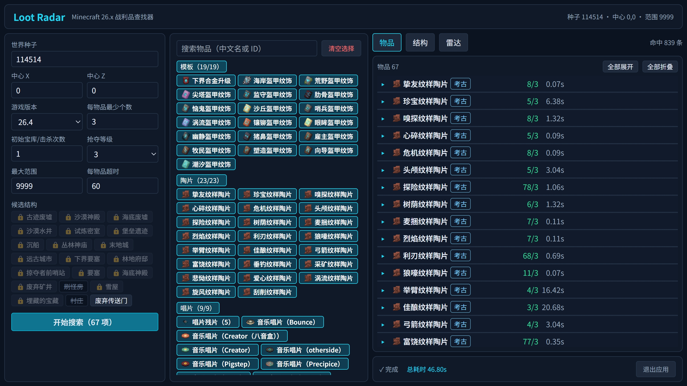

[English](README.en.md) | **简体中文**

# Loot Radar 战利品查找器

Minecraft JAVA 版战利品查找器，输入游戏版本、世界种子、中心坐标、搜索半径和目标物品，输出周围最近的 n 个可获得该物品的坐标，支持版本26.1.2、26.2、26.3、26.4。

# 结构

| 结构             | 维度   | 方式 | 覆盖 | 准确率 |
| ---------------- | ------ | ---- | ---- | ------ |
| 堡垒遗迹藏宝室   | 下界   | 箱子 | ✅   | 100%   |
| 堡垒遗迹桥       | 下界   | 箱子 | ✅   | 100%   |
| 堡垒遗迹塔尖     | 下界   | 箱子 | ✅   | 100%   |
| 堡垒遗迹疣猪兽棚 | 下界   | 箱子 | ✅   | 100%   |
| 沉船宝箱         | 主世界 | 箱子 | ✅   | 100%   |
| 沉船补给箱       | 主世界 | 箱子 | ✅   | 100%   |
| 沉船地图箱       | 主世界 | 箱子 | ✅   | 100%   |
| 丛林神庙         | 主世界 | 箱子 | ✅   | 100%   |
| 村庄武器匠小屋   | 主世界 | 箱子 | ✅   | 95.6%  |
| 大型海底废墟     | 主世界 | 箱子 | ✅   | 98.5%  |
| 废弃传送门       | 主世界 | 箱子 | ✅   | 99.7%  |
| 废弃传送门       | 下界   | 箱子 | ✅   | 100%   |
| 古迹废墟         | 主世界 | 考古 | ✅   | 100%   |
| 冷水海底废墟     | 主世界 | 考古 | ✅   | 99.3%  |
| 林地府邸         | 主世界 | 箱子 | ✅   | 100%   |
| 硫黄洞穴废弃矿井 | 主世界 | 矿车 | ✅   | 100%   |
| 掠夺者前哨站     | 主世界 | 箱子 | ✅   | 100%   |
| 埋藏的宝藏       | 主世界 | 箱子 | ✅   | 100%   |
| 末地城           | 末地   | 箱子 | ✅   | 100%   |
| 暖水海底废墟     | 主世界 | 考古 | ✅   | 97.8%  |
| 沙漠神殿         | 主世界 | 考古 | ✅   | 93.5%  |
| 沙漠神殿         | 主世界 | 箱子 | ✅   | 100%   |
| 沙漠水井         | 主世界 | 考古 | ✅   | 100%   |
| 试炼密室宝库     | 主世界 | 宝库 | ✅   | 100%   |
| 试炼密室不祥宝库 | 主世界 | 宝库 | ✅   | 100%   |
| 试炼密室陶罐     | 主世界 | 罐体 | ✅   | 93.8%  |
| 试炼密室柱廊陶罐 | 主世界 | 陶罐 | ✅   | 99.9%  |
| 刷怪房           | 主世界 | 箱子 | ✅   | 97.2%  |
| 下界要塞         | 下界   | 箱子 | ✅   | 100%   |
| 小型海底废墟     | 主世界 | 箱子 | ✅   | 98.7%  |
| 要塞图书馆       | 主世界 | 箱子 | ✅   | 100%   |
| 要塞走廊         | 主世界 | 箱子 | ✅   | 98.0%  |
| 远古城市         | 主世界 | 箱子 | ✅   | 98.1%  |
| 远古守卫者       | 主世界 | 生物 | ✅   | 100%   |
| 雪屋             | 主世界 | 箱子 | ✅   | 100%   |

> 准确率为26.4抽样检查

# 物品

| 陶片         | 结构         | 方式 | 覆盖 |
| ------------ | ------------ | ---- | ---- |
| 挚友纹样陶片 | 古迹废墟     | 考古 | ✅   |
| 珍宝纹样陶片 | 沙漠神殿     | 考古 | ✅   |
| 嗅探纹样陶片 | 暖水海底废墟 | 考古 | ✅   |
| 心碎纹样陶片 | 古迹废墟     | 考古 | ✅   |
| 危机纹样陶片 | 古迹废墟     | 考古 | ✅   |
| 头颅纹样陶片 | 沙漠神殿     | 考古 | ✅   |
| 探险纹样陶片 | 冷水海底废墟 | 考古 | ✅   |
| 树荫纹样陶片 | 暖水海底废墟 | 考古 | ✅   |
| 麦捆纹样陶片 | 古迹废墟     | 考古 | ✅   |
| 烈焰纹样陶片 | 古迹废墟     | 考古 | ✅   |
| 利刃纹样陶片 | 冷水海底废墟 | 考古 | ✅   |
| 狼嚎纹样陶片 | 古迹废墟     | 考古 | ✅   |
| 举臂纹样陶片 | 沙漠水井     | 考古 | ✅   |
| 佳酿纹样陶片 | 沙漠水井     | 考古 | ✅   |
| 弓箭纹样陶片 | 沙漠神殿     | 考古 | ✅   |
| 富饶纹样陶片 | 冷水海底废墟 | 考古 | ✅   |
| 垂钓纹样陶片 | 暖水海底废墟 | 考古 | ✅   |
| 采矿纹样陶片 | 沙漠神殿     | 考古 | ✅   |
| 悲恸纹样陶片 | 冷水海底废墟 | 考古 | ✅   |
| 爱心纹样陶片 | 古迹废墟     | 考古 | ✅   |
| 涡流纹样陶片 | 试炼密室陶罐 | 罐体 | ✅   |
| 旋风纹样陶片 | 试炼密室陶罐 | 罐体 | ✅   |
| 刮削纹样陶片 | 试炼密室陶罐 | 罐体 | ✅   |

| 模板         | 结构             | 方式 | 覆盖 |
| ------------ | ---------------- | ---- | ---- |
| 下界合金升级 | 堡垒遗迹塔尖     | 箱子 | ✅   |
| 下界合金升级 | 堡垒遗迹藏宝室   | 箱子 | ✅   |
| 下界合金升级 | 堡垒遗迹疣猪兽棚 | 箱子 | ✅   |
| 下界合金升级 | 堡垒遗迹桥       | 箱子 | ✅   |
| 海岸盔甲纹饰 | 沉船补给箱       | 箱子 | ✅   |
| 海岸盔甲纹饰 | 沉船宝箱         | 箱子 | ✅   |
| 海岸盔甲纹饰 | 沉船地图箱       | 箱子 | ✅   |
| 荒野盔甲纹饰 | 丛林神庙         | 箱子 | ✅   |
| 尖塔盔甲纹饰 | 末地城           | 箱子 | ✅   |
| 监守盔甲纹饰 | 远古城市         | 箱子 | ✅   |
| 肋骨盔甲纹饰 | 下界要塞         | 箱子 | ✅   |
| 恼鬼盔甲纹饰 | 林地府邸         | 箱子 | ✅   |
| 沙丘盔甲纹饰 | 沙漠神殿         | 箱子 | ✅   |
| 哨兵盔甲纹饰 | 掠夺者前哨站     | 箱子 | ✅   |
| 涡流盔甲纹饰 | 试炼密室不祥宝库 | 宝库 | ✅   |
| 镶铆盔甲纹饰 | 试炼密室宝库     | 宝库 | ✅   |
| 眼眸盔甲纹饰 | 要塞走廊         | 箱子 | ✅   |
| 眼眸盔甲纹饰 | 要塞图书馆       | 箱子 | ✅   |
| 幽静盔甲纹饰 | 远古城市         | 箱子 | ✅   |
| 猪鼻盔甲纹饰 | 堡垒遗迹塔尖     | 箱子 | ✅   |
| 猪鼻盔甲纹饰 | 堡垒遗迹藏宝室   | 箱子 | ✅   |
| 猪鼻盔甲纹饰 | 堡垒遗迹疣猪兽棚 | 箱子 | ✅   |
| 猪鼻盔甲纹饰 | 堡垒遗迹桥       | 箱子 | ✅   |
| 雇主盔甲纹饰 | 古迹废墟         | 考古 | ✅   |
| 牧民盔甲纹饰 | 古迹废墟         | 考古 | ✅   |
| 塑造盔甲纹饰 | 古迹废墟         | 考古 | ✅   |
| 向导盔甲纹饰 | 古迹废墟         | 考古 | ✅   |
| 潮汐盔甲纹饰 | 远古守卫者       | 生物 | ✅   |

| 唱片                          | 结构             | 方式 | 覆盖 |
| ----------------------------- | ---------------- | ---- | ---- |
| 唱片残片（5）                 | 远古城市         | 箱子 | ✅   |
| 音乐唱片（Bounce）            | 硫黄洞穴废弃矿井 | 矿车 | ✅   |
| 音乐唱片（Creator（八音盒）） | 试炼密室柱廊陶罐 | 陶罐 | ✅   |
| 音乐唱片（Creator）           | 试炼密室不祥宝库 | 宝库 | ✅   |
| 音乐唱片（otherside）         | 远古城市         | 箱子 | ✅   |
| 音乐唱片（otherside）         | 刷怪房           | 箱子 | ✅   |
| 音乐唱片（otherside）         | 要塞走廊         | 箱子 | ✅   |
| 音乐唱片（Pigstep）           | 堡垒遗迹塔尖     | 箱子 | ✅   |
| 音乐唱片（Precipice）         | 试炼密室宝库     | 箱子 | ✅   |
| 音乐唱片（Relic）             | 古迹废墟         | 考古 | ✅   |
| 音乐唱片（Flurry）            | 雪屋             | 箱子 | ✅   |

| 铠甲         | 结构           | 方式 | 覆盖 |
| ------------ | -------------- | ---- | ---- |
| 铁鹦鹉螺铠   | 沉船补给箱     | 箱子 | ✅   |
| 铁鹦鹉螺铠   | 埋藏的宝藏     | 箱子 | ✅   |
| 铁鹦鹉螺铠   | 大型海底废墟   | 箱子 | ✅   |
| 铁鹦鹉螺铠   | 小型海底废墟   | 箱子 | ✅   |
| 铁鹦鹉螺铠   | 沉船宝箱       | 箱子 | ✅   |
| 铁鹦鹉螺铠   | 沉船地图箱     | 箱子 | ✅   |
| 铜鹦鹉螺铠   | 沉船补给箱     | 箱子 | ✅   |
| 铜鹦鹉螺铠   | 埋藏的宝藏     | 箱子 | ✅   |
| 铜鹦鹉螺铠   | 大型海底废墟   | 箱子 | ✅   |
| 铜鹦鹉螺铠   | 小型海底废墟   | 箱子 | ✅   |
| 铜鹦鹉螺铠   | 沉船宝箱       | 箱子 | ✅   |
| 铜鹦鹉螺铠   | 沉船地图箱     | 箱子 | ✅   |
| 金鹦鹉螺铠   | 沉船补给箱     | 箱子 | ✅   |
| 金鹦鹉螺铠   | 埋藏的宝藏     | 箱子 | ✅   |
| 金鹦鹉螺铠   | 大型海底废墟   | 箱子 | ✅   |
| 金鹦鹉螺铠   | 小型海底废墟   | 箱子 | ✅   |
| 金鹦鹉螺铠   | 沉船宝箱       | 箱子 | ✅   |
| 金鹦鹉螺铠   | 沉船地图箱     | 箱子 | ✅   |
| 钻石鹦鹉螺铠 | 沉船补给箱     | 箱子 | ✅   |
| 钻石鹦鹉螺铠 | 埋藏的宝藏     | 箱子 | ✅   |
| 钻石鹦鹉螺铠 | 大型海底废墟   | 箱子 | ✅   |
| 钻石鹦鹉螺铠 | 小型海底废墟   | 箱子 | ✅   |
| 钻石鹦鹉螺铠 | 沉船宝箱       | 箱子 | ✅   |
| 钻石鹦鹉螺铠 | 沉船地图箱     | 箱子 | ✅   |
| 铁马铠       | 末地城         | 箱子 | ✅   |
| 铁马铠       | 刷怪房         | 箱子 | ✅   |
| 铁马铠       | 沙漠神殿       | 箱子 | ✅   |
| 铁马铠       | 要塞走廊       | 箱子 | ✅   |
| 铁马铠       | 村庄武器匠小屋 | 箱子 | ✅   |
| 铁马铠       | 下界要塞       | 箱子 | ✅   |
| 铁马铠       | 丛林神庙       | 箱子 | ✅   |
| 铜马铠       | 末地城         | 箱子 | ✅   |
| 铜马铠       | 刷怪房         | 箱子 | ✅   |
| 铜马铠       | 沙漠神殿       | 箱子 | ✅   |
| 铜马铠       | 要塞走廊       | 箱子 | ✅   |
| 铜马铠       | 村庄武器匠小屋 | 箱子 | ✅   |
| 铜马铠       | 下界要塞       | 箱子 | ✅   |
| 铜马铠       | 丛林神庙       | 箱子 | ✅   |
| 金马铠       | 废弃传送门     | 箱子 | ✅   |
| 金马铠       | 末地城         | 箱子 | ✅   |
| 金马铠       | 刷怪房         | 箱子 | ✅   |
| 金马铠       | 沙漠神殿       | 箱子 | ✅   |
| 金马铠       | 要塞走廊       | 箱子 | ✅   |
| 金马铠       | 村庄武器匠小屋 | 箱子 | ✅   |
| 金马铠       | 下界要塞       | 箱子 | ✅   |
| 金马铠       | 丛林神庙       | 箱子 | ✅   |
| 钻石马铠     | 远古城市       | 箱子 | ✅   |
| 钻石马铠     | 末地城         | 箱子 | ✅   |
| 钻石马铠     | 刷怪房         | 箱子 | ✅   |
| 钻石马铠     | 沙漠神殿       | 箱子 | ✅   |
| 钻石马铠     | 要塞走廊       | 箱子 | ✅   |
| 钻石马铠     | 村庄武器匠小屋 | 箱子 | ✅   |
| 钻石马铠     | 下界要塞       | 箱子 | ✅   |
| 钻石马铠     | 丛林神庙       | 箱子 | ✅   |

| 其他         | 结构             | 方式 | 覆盖 |
| ------------ | ---------------- | ---- | ---- |
| 涡流旗帜图案 | 试炼密室不祥宝库 | 宝库 | ✅   |
| 旋风旗帜图案 | 试炼密室宝库     | 宝库 | ✅   |
| 猪鼻旗帜图案 | 堡垒遗迹塔尖     | 箱子 | ✅   |
| 沉重核心     | 试炼密室不祥宝库 | 宝库 | ✅   |
| 海洋之心     | 埋藏的宝藏       | 箱子 | ✅   |
| 回响碎片     | 远古城市         | 箱子 | ✅   |
| 嗅探兽蛋     | 暖水海底废墟     | 考古 | ✅   |
| 下界合金锭   | 堡垒遗迹藏宝室   | 箱子 | ✅   |
